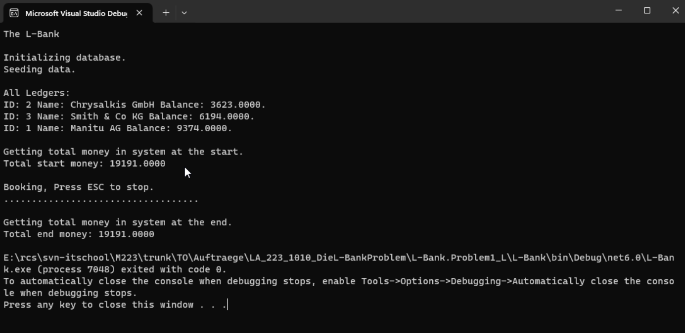
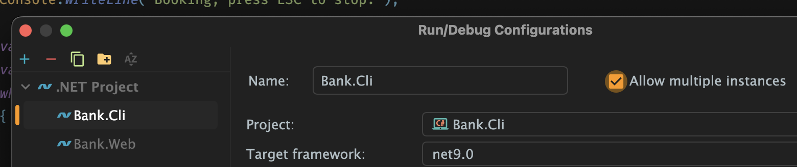

# Die Bank: Das Problem

## Ausgangslage

Du hast das erstellte Programm der Bank zum Laufen gebracht und analysiert. In diesem Teil geht es um die Multiuserprobleme.

## Teilaufgabe 1: Buchungen

Um den Betrieb zu simulieren, soll das Banking-Programm so erweitert werden, dass es den Betrieb simuliert und zufällige Buchungen vornimmt.  
Erweitere das Programm in `Simple.cs` an der Stelle, wo

```csharp
////////////////////
// Your Code Here
////////////////////
```

steht, sodass folgender Ablauf implementiert wird:

1. **Ausgabe:**  
   Schreibe auf der Konsole:  
   `Booking, press ESC to stop.`

2. **Konto auswählen:**  
   Wandle `allLedgers` in ein Array um, um ein zufälliges Konto auszuwählen.

3. **Buchungsablauf (solange nicht ESC gedrückt wird):**  
   - Wähle `from` als ein zufälliges Konto.  
   - Wähle `to` als ein zufälliges Konto.  
   - Bestimme `amount` als einen zufälligen Betrag zwischen 1 und 100.  
   - Führe die Buchung durch:  
     ```csharp
     ledgerRepository.Book(amount, from, to);
     ```
   - Gib einen Punkt auf der Konsole aus:  
     ```csharp
     Console.Write(".");
     ```

4. **Abschluss:**  
   Gib einen Zeilenumbruch auf der Konsole aus.

Der Ablauf sollte so aussehen:



**Frage:**  
Lass das Programm laufen. Verändert sich die Summe des Geldes im System? Sollte sie sich verändern?

---

## Teilaufgabe 2: Das erste Problem

Um mehrere User (Multiuser) zu simulieren, starte das Programm mehrfach (mindestens drei Mal).  
Je nach IDE musst du zudem die Build Config anpassen und mehrere parallele Instanzen erlauben – via der Checkbox **"Allow multiple instances"**.



**Fragen:**

- Verändert sich die Summe des Geldes im System? Sollte sie sich verändern?
- Warum verändert sich die Summe des Geldes?

Nimm an, dass es drei Konten gibt:

- **Ledger a:** 1000  
- **Ledger b:** 1000  
- **Ledger c:** 0

Lass das Programm zweimal laufen (**Instanz 1** und **Instanz 2**).

**Vorüberlegung:**  
Wenn das eine Programm (**Instanz a**) die Daten in der Datenbank ändert, ändern sich dann in den Ledger-Objekten des zweiten gestarteten Programms (**Instanz b**) die Daten?

Fülle die Daten zu folgendem Ablauf aus (exakt so, wie es das Programm machen würde):

### **Start:**

- **Datenbank:**  
  - Geld auf Ledger a: 1000  
  - Geld auf Ledger b: 1000  
  - Geld auf Ledger c: 0  
  - Geld Total: *[leer]*

### **Schritt 1: Instanz a und Instanz b lesen die Werte aus der Datenbank**

- **Programm Instanz a:**  
  - `balance` von Ledger a: 1000  
  - `balance` von Ledger b: 1000  
  - `balance` von Ledger c: 0

- **Programm Instanz b:**  
  - `balance` von Ledger a: 1000  
  - `balance` von Ledger b: 1000  
  - `balance` von Ledger c: 0

- **Datenbank:**  
  - Geld auf Ledger a: 1000  
  - Geld auf Ledger b: 1000  
  - Geld auf Ledger c: 0  
  - Geld Total: *[leer]*

### **Schritt 2: Instanz a bucht 10 von Ledger a auf Ledger b (und speichert a und b)**

- **Programm Instanz a:**  
  - `balance` von Ledger a: *[auszufüllen]*  
  - `balance` von Ledger b: *[auszufüllen]*  
  - `balance` von Ledger c: *[auszufüllen]*  
  - *(HERE LIE DRAGONS, denke gut nach)*

- **Programm Instanz b:**  
  - `balance` von Ledger a: *[auszufüllen]*  
  - `balance` von Ledger b: *[auszufüllen]*  
  - `balance` von Ledger c: *[auszufüllen]*

- **Datenbank:**  
  - Geld auf Ledger a: *[auszufüllen]*  
  - Geld auf Ledger b: *[auszufüllen]*  
  - Geld auf Ledger c: *[auszufüllen]*  
  - Geld Total: *[auszufüllen]*

### **Schritt 3: Instanz b bucht 20 von Ledger a auf Ledger c (und speichert a und c)**

- **Programm Instanz a:**  
  - `balance` von Ledger a: *[auszufüllen]*  
  - `balance` von Ledger b: *[auszufüllen]*  
  - `balance` von Ledger c: *[auszufüllen]*

- **Programm Instanz b:**  
  - `balance` von Ledger a: *[auszufüllen]*  
  - `balance` von Ledger b: *[auszufüllen]*  
  - `balance` von Ledger c: *[auszufüllen]*

- **Datenbank:**  
  - Geld auf Ledger a: *[auszufüllen]*  
  - Geld auf Ledger b: *[auszufüllen]*  
  - Geld auf Ledger c: *[auszufüllen]*  
  - Geld Total (💣): *[auszufüllen]*

**Frage:**  
Wie könnte dieses Problem behoben werden?

---

## Teilaufgabe 3: Beheben des Problems

Ergänze `LedgerRepository.cs` um eine Methode:

```csharp
public void LoadBalance(Ledger ledger)
{
    // SQL-Befehl: SELECT balance FROM {Ledger.CollectionName} WHERE id=@Id
    // Lies die Balance aus der Datenbank
}
```

Schau bei `LedgerRepository.GetTotalMoney()` nach, wie man einen Wert aus der Datenbank ausliest.  
Ergänze `LedgerRepository.Book(…)` wie folgt:

```csharp
public void Book(decimal amount, Ledger from, Ledger to)
{
    this.LoadBalance(from);
    from.Balance -= amount;
    this.Update(from);
    
    // Complicate calculations
    Thread.Sleep(250);
    
    this.LoadBalance(to);
    to.Balance += amount;
    this.Update(to);
}
```

**Frage:**  
Sollte das das erkannte Problem beheben?

Starte das Programm mehrfach und prüfe, ob nun kein Geld mehr verschwindet oder erzeugt wird.

---

**Houston, we have a problem…**