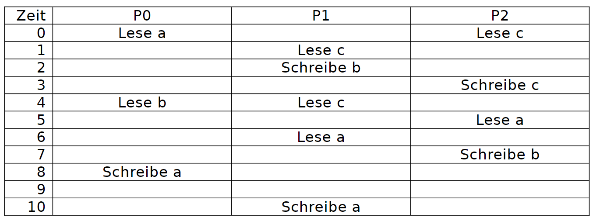
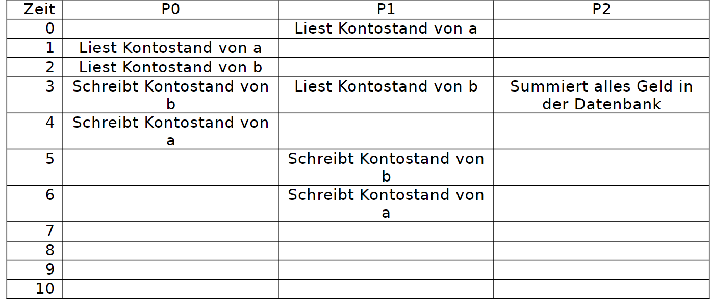
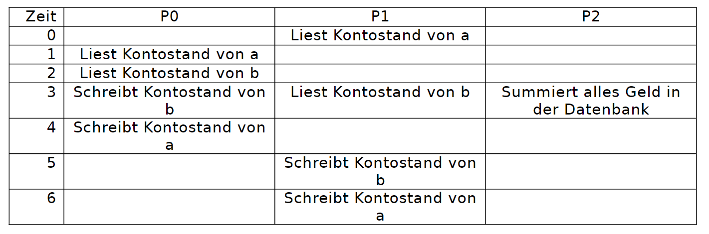
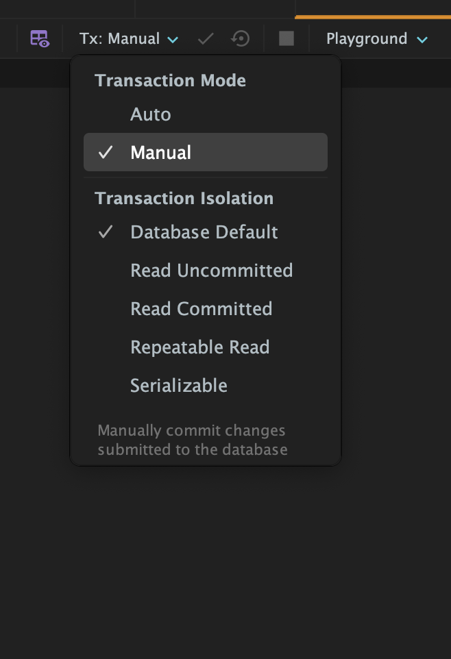

# Transaktionen

Die Relevanz von Transaktionen wurde gezeigt. Du hast einen lauffähigen MariaDB Container auf Deinem Laptop und die Beispieldatenbank `bank` ist vorhanden.

## Aufgabenstellung

In dieser Aufgabe werden Transaktionen theoretisch und praktisch erkundet.

### Teilaufgabe 1 Theoretische Analyse

In folgender Tabelle läuft die Zeit von oben nach unten. P0 bis P2 sind unterschiedliche Prozesse (Programme, User, …).  
a, b, c sind unterschiedliche Datensätze.



Gehe davon aus, dass wenn ein Prozess einen Datensatz (a, b oder c) liest und danach schreibt, er damit arbeitet und die Datenbank zu diesem Zeitpunkt inkonsistent ist.  
Versuche zu identifizieren, wo folgende Probleme auftreten können:

- Dirty Read
- Non-repeatable read
- Phantom Read
- Sich gegenseitig überschreibende Daten

Welchen Isolationslevel brauchst du, um diese Probleme zu verhindern?

### Teilaufgabe 2: Theoretische Analyse der Bank

Nimm folgenden Ablauf für die Bank:



Versuche zu identifizieren, wo folgende Probleme auftreten können:
- Dirty Read
- Non-repeatable read

Da keine Datensätze erstellt oder gelöscht werden, gibt es keine Phantom Reads  
Welchen Isolationslevel brauchst du, um diese Probleme zu verhindern?

P0 und P1:

P2:

### Teilaufgabe 3: Praktische Analyse der Bank

Hier simulieren wir diesen Ablauf mit und ohne Transaktionen «von Hand».  
Öffne dafür DataGrip.

Bereite folgende Dinge vor:

- ID des ersten Datensatz in der Tabelle ledgers (a):
- ID des zweiten Datensatz in der Tabelle ledgers (b):
- SQL-Befehl um alles Geld zu summieren:
- SQL-Befehl um den Kontostand von a auszulesen:
- SQL-Befehl um den Kontostand von b auszulesen:
- SQL-Befehl um den Kontostand von a neu zu schreiben:
- SQL-Befehl um den Kontostand von b neu zu schreiben:
- Summe des Geldes zu Beginn:
- Öffne drei Fenster für P0, P1 und P3:

Schreibe statt den Anweisungen nun die SQL-Befehle in die Tabelle.

- P0 soll 20 von a zu b buchen.
- P1 soll 30 von b zu a buchen.



| Zeit | P0 | P1 | P2 |
| --- | --- | --- | --- |
| 0 | | | |
| 1 | | | |
| 2 | | | |
| 3 | | | |
| 4 | | | |
| 5 | | | |
| 6 | | | |

Gehe nun folgendermassen vor:

**Zeit 0:**  
Öffne den zweiten SQL-Tab, frage den Kontostand von a ab und schreibe ihn auf:
```sql
SELECT balance FROM ledgers WHERE id = 1
```

**Zeit 1:**  
Öffne den dritten SQL-Tab, frage den Kontostand von a ab und schreibe ihn auf

**Zeit 2:**  
Öffne den ersten SQL-Tab, frage den Kontostand von b ab und schreibe ihn auf

**Zeit 3:**  
P0 soll 20 von a zu b buchen.

Rechne hier den neuen Kontostand von b aus (den bei Zeit 2 + 20):

Öffne den ersten SQL-Tab und schreibe dieses Resultat in das Feld balance von b.

Öffne den zweiten SQL-Tab, frage den Kontostand von b ab und schreibe ihn auf:

Öffne das dritte Fenster und frage die Summe allen Geldes in Ledgers ab:

Fällt dir etwas auf?

**Zeit 4:**  
P0 soll 20 von a zu b buchen.

Rechne hier den neuen Kontostand von a aus (den bei Zeit 1 - 20):

Öffne den ersten SQL-Tab und schreibe dieses Resultat in das Feld balance von a.

**Zeit 5:**  
P1 soll 30 von b zu a buchen.

Rechne hier den neuen Kontostand von b aus (den bei Zeit 3 für P1 - 30):

Öffne den zweiten SQL-Tab und schreibe dieses Resultat in das Feld balance von b.

**Zeit 6:**  
Ja, du musst den Befehl nochmals eingeben, sonst weiss die Datenbank nicht, dass dieser Prozess an diesen Daten interessiert ist.

P1 soll 30 von b zu a buchen.

Rechne hier den neuen Kontostand von a aus (den bei Zeit 0 + 30):

Öffne den zweiten SQL-Tab und schreibe dieses Resultat in das Feld balance von a.

Und zum Spass: Wie viel Geld haben wir nun in der Datenbank?

Fällt dir was auf?

### Teilaufgabe 4: Praktische Analyse der Bank mit Transaktionen

Stelle für die ersten beiden SQL-Tabs die Isolation «Serializable» ein und für die dritte Tab «Read Committed» (Lösung aus Aufgabe 2).



Starte in jedem der drei Tabs eine Transaktion, indem du «BEGIN TRANSACTION;» eingibst und auf «Execute» klickst.

Führe die Befehle aus der Tabelle erneut aus.

Was fällt dir auf?