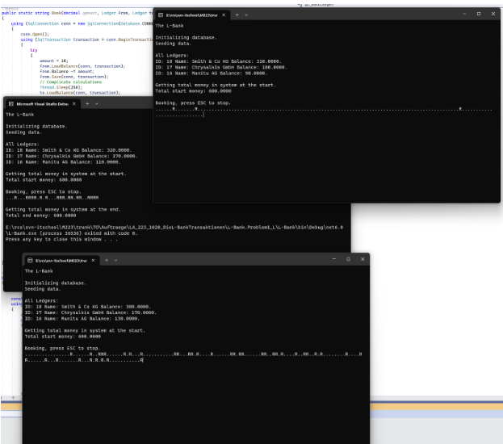

# Transaktionen Teil 2

## Ausgangslage

Du hast das Programm für die Bank, das leider Geld erzeugt und vernichtet.
Du hast auch das Theoretische Wissen über Transaktionen und den Ablauf schon durchgespielt.

## Aufgabenstellung

Fixe die Bank.

### Teilaufgabe 1: Transaktionen

Ersetze die Funktionen `Book`, `GetAllLedgers` und `GetTotalMoney` im `LedgerRepository` durch den Code unterhalb. Später kannst du den Code auch mit Entity Framework umbauen.

```csharp
    public string Book(decimal amount, Ledger from, Ledger to)
    {
        using (MySqlConnection conn = new MySqlConnection(this.databaseSettings.ConnectionString))
        {
            conn.Open();
            using (MySqlTransaction transaction = conn.BeginTransaction(IsolationLevel.Serializable))
            {
                try
                {
                    amount = 10;
                    from.Balance = this.GetBalance(from.Id, conn, transaction) ?? throw new ArgumentNullException();
                    from.Balance -= amount;
                    this.Update(from, conn, transaction);
                   // Complicate calculations
                    Thread.Sleep(250);
                    to.Balance = this.GetBalance(to.Id, conn, transaction) ?? throw new ArgumentNullException();
                    to.Balance += amount;
                    this.Update(to, conn, transaction);

                    // Console.WriteLine($"Booking {amount} from {from.Name} to {to.Name}");

                    transaction.Commit();
                    return ".";
                }
                catch (Exception ex)
                {
                    //Console.WriteLine("Commit Exception Type: {0}", ex.GetType());
                    //Console.WriteLine("  Message: {0}", ex.Message);

                    // Attempt to roll back the transaction.
                    try
                    {
                        transaction.Rollback();
                        return "R";
                    }
                    catch (Exception ex2)
                    {
                        // Handle any errors that may have occurred on the server that would cause the rollback to fail.
                        //Console.WriteLine("Rollback Exception Type: {0}", ex2.GetType());
                        //Console.WriteLine("  Message: {0}", ex2.Message);
                        return "E";
                    }
                }
            }
        }
    }

    public IEnumerable<Ledger> GetAllLedgers()
    {
        var allLedgers = new HashSet<Ledger>();

        const string query = @$"SELECT id, name, balance FROM {Ledger.CollectionName}";
        using (MySqlConnection conn = new MySqlConnection(this.databaseSettings.ConnectionString))
        {
            conn.Open();
            using (MySqlCommand cmd = new MySqlCommand(query, conn))
            {
                using (SqlDataReader reader = cmd.ExecuteReader())
                {
                    while (reader.Read())
                    {
                        int id = reader.GetInt32(reader.GetOrdinal("id"));
                        string name = reader.GetString(reader.GetOrdinal("name"));
                        decimal balance = reader.GetDecimal(reader.GetOrdinal("balance"));

                        allLedgers.Add(new Ledger()
                        {
                            Balance = balance,
                            Id = id,
                            Name = name
                        });
                    }
                }
            }
        }

        return allLedgers.ToImmutableHashSet<Ledger>();
    }

    public decimal GetTotalMoney()
    {
        const string query = @$"SELECT SUM(balance) AS TotalBalance FROM {Ledger.CollectionName}";
        decimal totalBalance = 0;

        using (MySqlConnection conn = new MySqlConnection(this.databaseSettings.ConnectionString))
        {
            conn.Open();
            using (MySqlTransaction transaction = conn.BeginTransaction(IsolationLevel.ReadCommitted))
            {
                try
                {
                    using (SqlCommand cmd = new SqlCommand(query, conn, transaction))
                    {
                        object result = cmd.ExecuteScalar();
                        if (result != DBNull.Value)
                        {
                            totalBalance = Convert.ToDecimal(result);
                        }
                    }
                }
                catch (Exception ex)
                {
                    Console.WriteLine("Commit Exception Type: {0}", ex.GetType());
                    Console.WriteLine("  Message: {0}", ex.Message);

                    // Attempt to roll back the transaction.
                    try
                    {
                        transaction.Rollback();
                    }
                    catch (Exception ex2)
                    {
                        // Handle any errors that may have occurred on the server that would cause the rollback to fail.
                        Console.WriteLine("Rollback Exception Type: {0}", ex2.GetType());
                        Console.WriteLine("  Message: {0}", ex2.Message);
                    }
                }
            }

            return totalBalance;
        }
    }

```

Passe zudem das Interface entsprechend an.

Wenn du dies gemacht hast, passe das Programm.cs an, sodass die Zeile `Simple.Run();` auskommentiert wird und die Zeile `WithTransactions.Run();` einkommentiert wird. Danach sollte es so aussehen: 

```csharp
// Simple.Run(ledgerRepository);

WithTransactions.Run(allLedgers, ledgerRepository);
```

Kommentiere zudem die Zeile 20 in `WithTransactions.cs` ein.

Ergänze `LedgerRepository.cs` mit Transaktionen.

Hinweis:
Pass auf, dass alles in der gleichen Transaktion passiert. Im Code oben wird die Transaktion in der Methode `Book` geöffnet und an die `Update` Methode weitergegeben. Sprich jedes Mal, wenn du von einer Methode im `LedgerRepository` eine andere Methode im `LedgerRepository` aufrufst, musst du die Transaktion weitergeben.


```csharp
    // Book öffnet die Transaktion
    public void Book(decimal amount, Ledger from, Ledger to);
    // Update erhält die existierende Transaktion
    void Update(Ledger ledger, MySqlConnection conn, MySqlTransaction transaction);
```

Starte das Programm und vergewissere dich, dass es im Singleusermodus noch läuft.

### Teilaufgabe 2: Ausgabe

Gib bei jeder erfolgreichen Transaktion einen Punkt, für jedes Rollback ein "R" und für jeden Rollbackfehler ein "E" aus.

Starte das Programm mehrfach.

Die Ausgabe sollte wie folgt aussehen:

