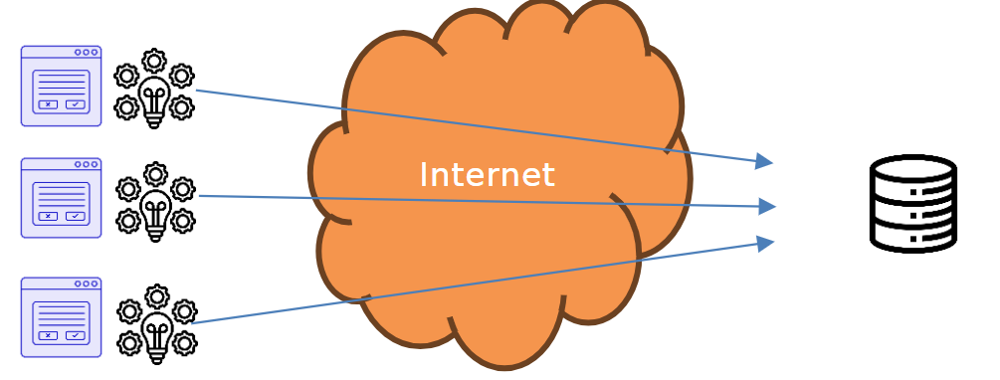
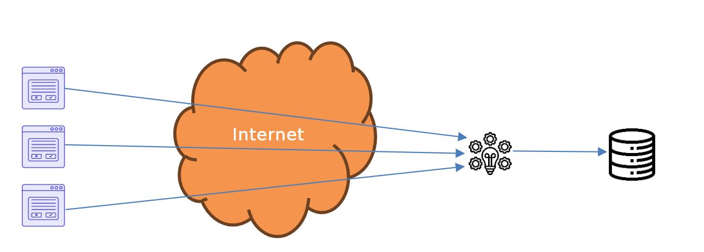

# Sicherheitsüberlegungen für die Architektur

## Ausgangslage

Du hast mit der Bank eine simple Multiuser-Datenbank-Applikation entworfen. Allerdings hast du dabei keine Sicherheitsüberlegungen gemacht. In diesem Auftrag soll einleuchtend gezeigt werden, warum es eine Multitier-Architektur braucht.

Nimm an, du entwickelst eine Applikation wie ein Ticket-Reservationssystem, eine Bank, eine Dating-Applikation oder eine Schulverwaltungssoftware. Alle diese Applikationen haben folgende Epics gemeinsam:

- **Grafische Benutzeroberfläche:**  
  Die Benutzer:innen sollen mit einer grafischen Benutzerschnittstelle (GUI) arbeiten können.
- **Gemeinsame Datenbasis:**  
  Alle Benutzer:innen sollen auf dieselbe Datenbasis zugreifen (d.h. sie greifen auf dieselbe Datenbank zu).
- **Gleichzeitige Zugriffe:**  
  Die Zugriffe können gleichzeitig erfolgen.

## Aufgabenstellung

Bestimme eine korrekte und vernünftige Architektur.

### Teilaufgabe 1: Hypothese

Laut Aufgabenstellung hast du folgende Komponenten:

- **GUI:**  
  Ein Programm, das die Benutzeroberfläche darstellt.
- **Businesslogik:**  
  Dort, wo die Aufgaben erledigt werden – z.B. Buchungen in einer Konto-Applikation, Absenzen zählen in einer Schulverwaltung, Matches generieren in einer Dating-Applikation (also dort, wo die Musik spielt).
- **Datenbank:**  
  Eine zentrale Datenspeicherung.
- **Netzwerk:**  
  Da du eine Datenbank hast, brauchst du auch ein Netzwerk.

Ordne die Komponenten so an, wie du denkst, dass es Sinn ergibt, und verbinde sie.

- **GUI (3 Benutzer:innen):**  
  
- **Businesslogik:**  
  
- **Datenbank:**  
  

Es gibt noch eine Entscheidung, die du treffen musst: **Wie verbindest du dich mit der Datenbank?**

Du hast zwei Möglichkeiten:

- **Variante 1:**  
  Jeder Benutzer verbindet sich mit ein und demselben User auf der Datenbank. Du programmierst die Authentifizierung und Autorisierung selbst.
- **Variante 2:**  
  Für jeden Benutzer wird in der Datenbank ein eigener User angelegt. Damit kann die Rechteverwaltung der Datenbank genutzt werden. Grundsätzlich kannst du für Benutzer die Rechte zum Zugriff auf Tabellen (einfügen, löschen, Schema ändern, …) vergeben.

Beantworte folgende Fragen zu deiner Hypothese:

- Wie gelangen die Daten in die Datenbank?
- Was befindet sich auf dem Rechner der Benutzer:innen?
- Was befindet sich auf einem Server?
- Welche Variante zur Verbindung hast du gewählt? Variante 1 oder 2?

### Teilaufgabe 2: Das Problem

Eine Möglichkeit wäre, ein Programm mit GUI zu entwickeln, bei dem die Businesslogik integriert ist und das über das Internet die Datenbankverbindung herstellt.

#### Das Problem mit Variante 1

Nimm an, es wird mit Variante 1 gearbeitet:  
Jeder Benutzer verbindet sich mit ein und demselben User auf der Datenbank.

- Der Username und das Passwort müssen in der GUI-Applikation gespeichert werden, sonst kann sie nicht auf die Datenbank zugreifen.
- Es besteht die Möglichkeit, aus den exe-Dateien von .NET-Programmen den Quellcode zu extrahieren.  
  Installiere **dotPeek5**, einen der besten Dekompilierer.
- Lade das Beispielprogramm **2-Tier-Security-Release** herunter und starte es:  
  [2-Tier-Security-Release](./Beispielprogramm/2-Tier-Security-Release.zip)
- Starte dotPeek und öffne die exe-Datei. Du siehst den Quellcode.
- Wähle:  
  `2-Tier-Security` → `_2_Tier_Security` → `Form1` → dann `Form1.cs`

_Fällt dir etwas – für die Betreiber der Applikation – unangenehmes auf? Was ziehst du daraus für Schlüsse?_

#### Das Problem mit Variante 2

Nimm an, es wird mit Variante 2 gearbeitet:  
Für jeden Benutzer wird in der Datenbank ein eigener User angelegt. In der Applikation wird ein Loginfenster angezeigt, und so müssen keine Benutzernamen und Passwörter in der Applikation gespeichert werden.

Nun gibt es ein neues Problem:  
Angenommen, eine Benutzerin möchte etwas buchen. Natürlicherweise darf diese Person nur von ihrem eigenen Konto buchen! Der angelegte User muss jedoch das Änderungsrecht auf diese Tabelle besitzen, sonst kann gar nicht gebucht werden.  
Zwar verhindert das die GUI, aber was würdest du als kreative/r Hacker:in vorschlagen?

### Teilaufgabe 3: Lösung

Beantworte folgende Fragen:

- **Varianten für Username und Passwort:**  
  Welche Varianten für Username und Passwort sind denkbar?
- **Probleme bei Variante 1:**  
  Weshalb treten die Probleme bei Variante 1 (jeder Benutzer verbindet sich mit ein und demselben User auf der Datenbank) nicht auf?
- **Probleme bei Variante 2:**  
  Weshalb treten die Probleme bei Variante 2 (für jeden Benutzer wird in der Datenbank ein eigener User angelegt) nicht auf?

**Schlechte Nachricht:**  
Das wird komplex.

**Gute Nachricht:**  
Du kannst dein Wissen aus dem Modul *295 Backend für Applikationen realisieren* anwenden.