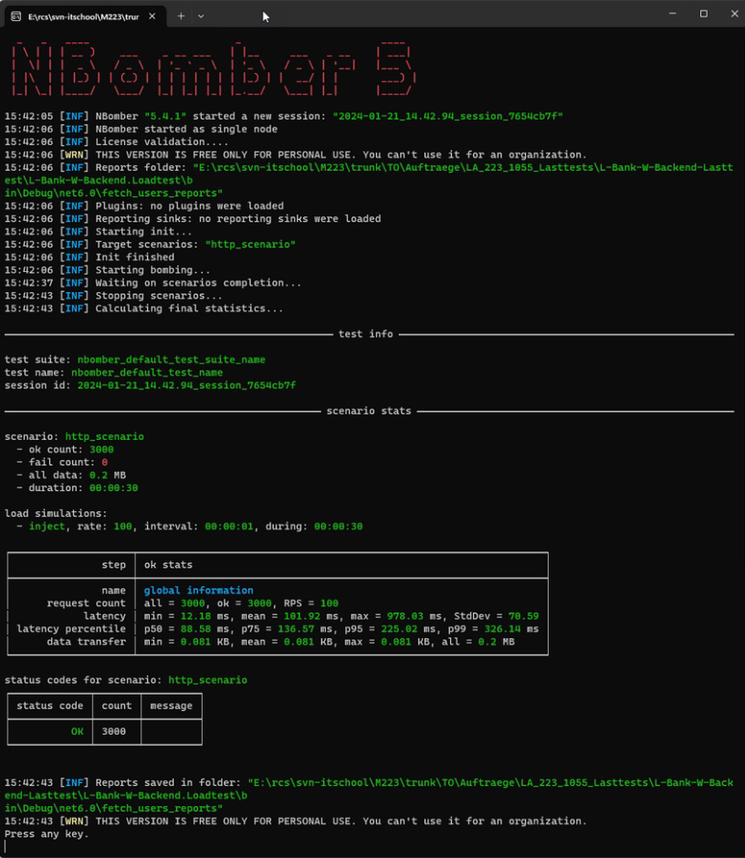
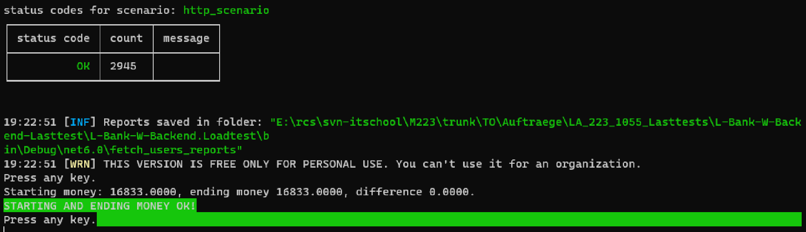

# Lasttests

Um sicherzustellen, dass deine Applikation auch unter erhöhter Last richtig funktioniert, teste auch diesen Aspekt.

## Aufgabenstellung

Erstelle Last-Tests, die speziell auf die Multiuserprobleme abzielen.

### Teilaufgabe 1: Basis aufbauen

Erstelle in deiner Solution ein neues Konsolen-Projekt mit dem Namen `Bank.Tests.Loadtest.Cli`.

Passe die `Main`-Methode inklusive der Definition an:

```csharp
using System;
using System.Threading.Tasks;

namespace Bank.Tests.Loadtest.Cli
{
    class Program
    {
        static async Task Main(string[] args)
        {
            string jwt = await Login("admin", "adminpass");
            var ledgers = await GetAllLedgers(jwt);
            foreach (var ledger in ledgers)
            {
                Console.WriteLine(ledger.Name);
            }

            Console.WriteLine("Press any key to exit");
            Console.ReadKey();
        }
    }
}
```

Implementiere die beiden Methoden `Login(…)`, die einloggt und ein JWT-Token zurückgibt, und `GetAllLedgers(…)`, die alle Ledgers zurückgibt. Beide Methoden sollen die API verwenden und nicht direkt Code aufrufen. Tipp: Du kannst dich am `ApiService` im Frontend orientieren, der beide Methoden in ähnlicher Form enthält.

> **Hinweis:** Das Backend muss natürlich laufen, damit es die API-Anfragen beantworten kann.

### Teilaufgabe 2: NBomber

Lies dich in [Lasttests mit NBomber](https://blog.noser.com/lasttests-mit-nbomber/) und in die [NBomber-Dokumentation](https://nbomber.com/docs/getting-started/overview) ein, um zu verstehen, was NBomber ist und wie es angewendet wird.

Installiere folgende NuGet-Packages in dieses neue Projekt:
- **NBomber**
- **NBomber.Http**

Um zu testen, ob NBomber grundsätzlich funktioniert, integriere den Code aus dem [Hello World Tutorial](https://nbomber.com/docs/getting-started/hello_world_tutorial#create-production-ready-http-load-test) (Abschnitt „Create production-ready HTTP load test“) in deinen bestehenden Code.

Passe folgende Punkte an:
- Die URL sollte `https://localhost:5000/api/v1/bankinfo` sein.
- Lasse einen Report erstellen und ergänze den entsprechenden Codeabschnitt:

    ```csharp
    NBomberRunner
        .RegisterScenarios(scenario)
        .WithReportFileName("fetch_users_report")
        .WithReportFolder("fetch_users_reports")
        .WithReportFormats(ReportFormat.Html)
        .Run();
    ```

- Füge am Ende `Console.ReadKey();` ein.

Wenn du nun das Backend und dieses Programm startest, solltest du eine Ausgabe wie folgt sehen:



Ganz unten siehst du einen Abschnitt „Reports saved in …“. In diesem Ordner solltest du eine HTML-Datei mit allen Resultaten finden.

Finde heraus, wie viele Anfragen gestartet wurden und wie lange sie im Durchschnitt gedauert haben.

### Teilaufgabe 3: Überprüfen des Geldbetrags

Frage zu Beginn und am Ende über das API alle Ledgers ab. Vergleiche den Geldbetrag am Ende und gib auf der Konsole aus, ob sich der Geldbetrag geändert hat. Im Idealfall sollte es etwa so aussehen:



### Teilaufgabe 4: Testen des Booking APIs

Schreibe das Beispiel so um, dass du das Booking API stresstesten kannst. Studiere den Report und überlege, was die „Conflict“-Rückmeldungen im Szenario bedeuten.

**Hinweise:**

- Du kannst dich am Frontend orientieren, das das Backend aufruft.
- Der Aufruf sieht wie folgt aus:

    ```csharp
    var request = Http.CreateRequest("POST", "http://localhost:5000/api/v1/bookings")
        .WithHeader("Accept", "application/json")
        .WithHeader("Authorization", $"Bearer {jwt}")
        .WithBody(jsonContent);
    var response = await Http.Send(httpClient, request);
    ```

Viel Erfolg bei deinen Lasttests!