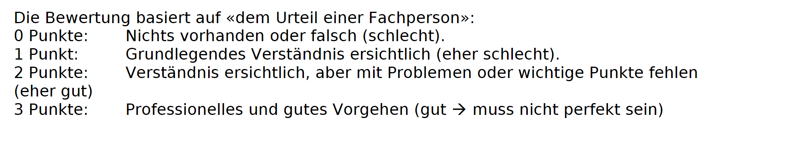

# Leistungsbeurteilung

**Modulnummer:** 223  
**Modulbezeichnung:** Multi-User-Applikationen objektorientiert realisieren  
**Zugrundeliegende LBV:** LBV 223-2  
**Punkteverteilung:** Praktische Umsetzungsarbeit 100%  

**Autoren:** Andy Bigler (Swisscom), Gabriel Frischknecht (co-ne GmbH)
**Erstellungsdatum:** 04. Mai 2025  
**Letzte Überarbeitung:** 25. November 2025  
**LB-Nr.:** LB-223-2-0  
**Überprüft durch:** Dimitri Waber (BBC AG)
**Datum der Überprüfung:** 11. August 2025

---

## Persönliche Angaben der lernenden Person

- **Vorname und Name:** *(eintragen)*  
- **Lehrbetrieb:** *(eintragen)*  
- **Gruppe / Kursnummer:** 223  
- **Prüfungsdatum:** *(eintragen)*  
- **Prüfungsort:** *(eintragen)*  

---

## Prüfungsergebnis

- **Erreichte Punktzahl:** *___* von *___* Punkten  
- **Prüfungsnote:**  
  Berechnung: `(5 * Erreichte Punktzahl) / Maximalpunktzahl + 1`  
  Ergebnis wird auf **0.5** gerundet  

---

## Praktische Prüfung

### Geprüfte Handlungsziele

1. Einschätzen, ob eine Datenbank die Anforderungen der Multi-User-Fähigkeit erfüllt und allfällige Anpassungen dokumentieren.  
2. Applikation entwerfen und mittels Transaktionen Multi-User-Fähigkeit sicherstellen.  
3. User Interfaces, Datenbankanpassungen und Transaktionen implementieren.  
4. Testspezifikation für funktionale und nicht-funktionale Aspekte der Multi-User-Fähigkeit definieren, Applikation testen und Tests protokollieren.  
5. Transaktionen dokumentieren und dabei auf Wartbarkeit und Nachvollziehbarkeit achten.

---

## Prüfungsform

- **Prüfungsform:** Praktische Umsetzungsarbeit  
- **Gewichtung in %:** 100%  
- **Dauer:** 5 Tage  
- **Maximale Punktzahl:** 40 Punkte

---

## Bewertungskriterien

| Kriterium                                                                                     | Gewichtung | Kriterium |
|-----------------------------------------------------------------------------------------------|------------|---|
| Analyse der Anforderungen hinsichtlich Mehrbenutzeranforderungen                              | 10%        | 1 |
| Benutzerinterfaceanpassungen für mehrere Benutzer implementieren                              | 20%        | 2 |
| Mehrbenutzeranforderungen und deren Fehlerbehandlung implementieren                           | 20%        | 3 |
| Transaktionen und deren Fehlerbehandlung implementieren                                       | 20%        | 4 |
| Testspezifikation schreiben und Tests durchführen                                             | 20%        | 5 |
| Tests durchführen                                                                             | 10%        | 6 |

---

## Hilfsmittel

- Kursdokumentation  
- Eigene Dokumentation mit Codebeispielen  
- Eingebaute Hilfe der Entwicklungsumgebung

# Bewertungskriterien

### 1 Analyse der Anforderungen hinsichtlich Mehrbenutzeranforderungen (10%) - 4 Punkte

| Kriterium                                                        | Max Punkte |
|------------------------------------------------------------------|------------|
| Die Massnahmen sind konkret **beschrieben**, belegt und machen Sinn. | 4          |

1 Punkt für jede korrekte Massnahme, maximal 4 Punkte. 0.5 Punkte wenn die Massnahme nicht beschrieben, oder nicht implementiert ist.

---

### 2 Benutzerinterfaceanpassungen für mehrere Benutzer implementieren (20%) - 8 Punkte

| Kriterium                                                                  | Max Punkte |
|----------------------------------------------------------------------------|------------|
| Die Applikation stellt alle Frontend Funktionen gemäss Fallbeschreibung zur Verfügung. | 2    |
| Es wurde zwei weitere Funktionalitäten im Frontend implementiert.            | 6          |

Wenn nicht alle funktionalitäten gemäss Fallbeschreibung implementiert sind, werden die Punkte für die Frontend Funktionalitäten nicht vergeben.

Für jede weitere funktionalität im Frontend gibt es 2 Punkte. Wenn diese auch mit Fehlerbehandlung implementiert sind, gibt es 3 Punkte.

---

### 3 Mehrbenutzeranforderungen und deren Fehlerbehandlung implementieren (20%) - 8 Punkte

| Kriterium                                                                  | Max Punkte |
|----------------------------------------------------------------------------|------------|
| Die Applikation stellt alle Backend Funktionen gemäss Fallbeschreibung zur Verfügung. | 2          |
| Es wurden zwei weitere Funktionalitäten im Backend implementiert.                    | 6          |

Wenn nicht alle funktionalitäten gemäss Fallbeschreibung implementiert sind, werden die Punkte für die Backend Funktionalitäten nicht vergeben.

Für jede weitere funktionalität im Backend gibt es 2 Punkte. Wenn diese auch mit Fehlerbehandlung implementiert sind, gibt es 3 Punkte.

---

### 4 Transaktionen und deren Fehlerbehandlung implementieren (20%) - 8 Punkte

| Kriterium                                                                  | Max Punkte |
|----------------------------------------------------------------------------|------------|
| Die Applikation verfügt über alle Fehlerbehandlungen gemäss Fallbeschreibung zur Verfügung. | 2          |
| Die Lasttests sind korrekt implementiert funktionieren.                    | 4          |
| Die Herausforderung wie deren Lösung ist korrekt dokumentiert.             | 2          |

Wenn nicht alle funktionalitäten gemäss Fallbeschreibung implementiert sind, werden die Punkte für die Transaktionen nicht vergeben.

Für die implementation der Lasttests gibt es 2 Punkte. Wenn diese auch richtig funktionieren, gibt es 4 Punkte.
---

### 5 Testspezifikation schreiben und Tests durchführen (20%) - 8 Punkte

| Kriterium                                                                                   | Max Punkte |
|---------------------------------------------------------------------------------------------|------------|
| Manuelle Tests sind dokumentiert und deren durchführung beschrieben                         | 5          |
| Die unit Tests sind korrekt dokumentiert                                                    | 3          |

Pro Testfall 1 Punkt.

---

### 6 Tests durchführen (10%) - 4 Punkte

| Kriterium                                                                                   | Max Punkte |
|---------------------------------------------------------------------------------------------|------------|
| Die Unittests sind korrekt implementiert und funktionieren.                                | 3          |
| Es wird an einem Beispiel plausibel gezeigt, dass die Unit- oder Lasttests funktionieren.  | 1          |

Pro Testfall 1 Punkt, maximal 3 Punkte.
---

## Hinweise

* Die Fallbeschreibung beinhaltet Teilaufgabe 1 und 2 in [04_Weiterentwicklung/01_Weitere_Features.md](./04_Weiterentwicklung/01_Weitere_Features.md). Das Feature muss von der Datenbank, über das Backend bis zum Frontend implementiert werden.
* Die Massnahmen vom 3. Kriterium bezieht sich auf die Transaktionssicherheit. Die Notizen dazu sind im README zu machen. Erklärt hier auch wie eure Zusatzfeatures die Transaktionssicherheit sicherstellen.
* Das Kriterium "Es wird an einem Beispiel plausibel gezeig..." bezieht sich auf die Transaktionssicherheit die via Unittests und Lasttests sichergestellt werden soll. Dokumentiert im README oder im Code welche Tests explizit die Transaktionssicherheit prüfen.
* Nur das erste zusätzliche Feature benötig Unittests. Beim zweiten Feature reicht es, wenn es funktioniert. Mindestens ein Feature benötigt ein Sequenzdiagramm.

