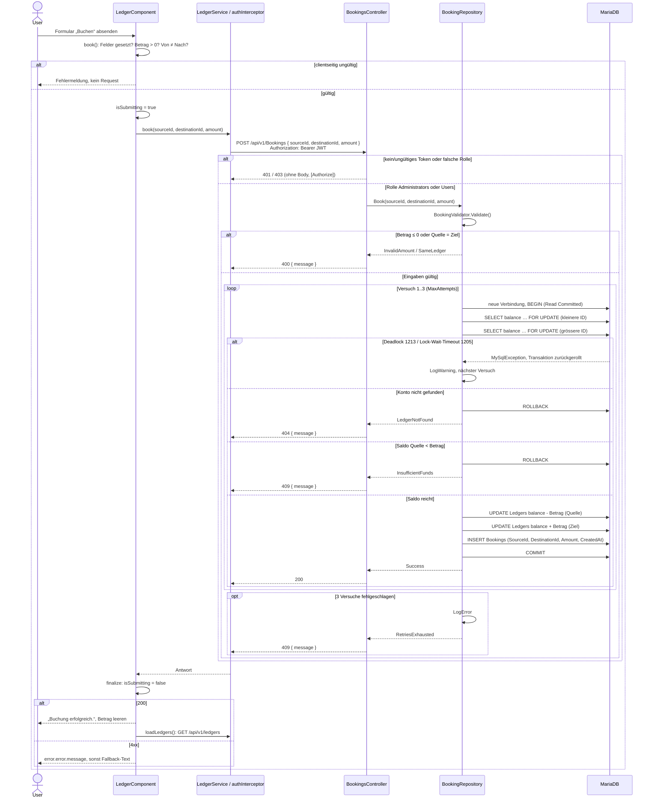

# Sequenzdiagramm Buchen

Ablauf einer Buchung vom Formular bis zur Datenbank, so wie er im Code umgesetzt ist (`ledger.component.ts` → `ledger.service.ts` / `auth.interceptor.ts` → `BookingsController` → `BookingRepository.Book()` → MariaDB).

## Massnahmen aus der Analyse

- **Massnahme 1 (Transaktion):** Alles zwischen `BEGIN (Read Committed)` und `COMMIT` bzw. `ROLLBACK` läuft auf einer Verbindung in einer Transaktion (`BookingRepository.TryBook()`), eine halbe Buchung kann es also nicht geben.
- **Massnahme 2 (Saldo-Prüfung):** Beide Konten werden mit `SELECT … FOR UPDATE` gesperrt, und der Saldo wird auf der gesperrten Zeile geprüft. Bis zum Commit kann niemand den Saldo ändern, das verhindert Lost Update und Saldo unter 0.
- **Massnahme 3 (Retry, Sperr-Reihenfolge):** Die Konten werden immer in der Reihenfolge kleinere ID vor grösserer ID gesperrt, was Deadlocks selten macht. Tritt trotzdem 1213 oder 1205 auf, startet der `loop` die ganze Buchung mit neuer Verbindung neu, nach 3 Versuchen gibt es 409 statt 500.
- **Massnahme 4 (Historie):** `INSERT Bookings` läuft in derselben Transaktion wie die beiden `UPDATE`. Ein Rollback oder ein abgebrochener Versuch hinterlässt deshalb keinen Eintrag.

Hinweise zum Diagramm: Mermaid kann einen `loop` nicht vorzeitig verlassen. Im Code beenden die Zweige 404, 409 und 200 die Schleife sofort, nur 1213/1205 führen zum nächsten Versuch. Andere Datenbankfehler werden nicht abgefangen und enden als 500.
