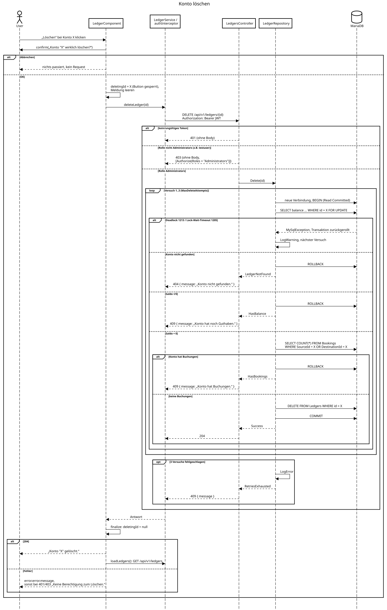

# Sequenzdiagramm Konto löschen

Ablauf beim Löschen eines Kontos (Zusatz-Feature 1) vom Button bis zur Datenbank, so wie er im Code umgesetzt ist (`ledger.component.ts` → `ledger.service.ts` / `auth.interceptor.ts` → `LedgersController` → `LedgerRepository.Delete()` → MariaDB).

Erstellt mit Hilfe von https://sequencediagram.org/. Quelltext: [sequenzdiagramm-loeschen.sd.txt](sequenzdiagramm-loeschen.sd.txt). Zum Bearbeiten den Text auf sequencediagram.org einfügen oder das SVG dort öffnen (es enthält den Quelltext).

## Massnahmen aus der Analyse

Prüfung und `DELETE` laufen in einer Transaktion (wie Massnahme 1), und das Konto wird mit `SELECT … FOR UPDATE` gesperrt, sodass Saldo und Buchungen auf der gesperrten Zeile geprüft werden (wie Massnahme 2). Eine gleichzeitige Buchung auf dasselbe Konto sperrt es ebenfalls und wartet deshalb auf das Löschen oder umgekehrt, so kann kein Geld verschwinden und keine Buchung auf ein gelöschtes Konto entstehen. Deadlocks und Lock-Wait-Timeouts fängt dieselbe Retry-Schleife ab wie beim Buchen (Massnahme 3), nach 3 Versuchen gibt es 409 statt 500.

Hinweise zum Diagramm: Ein `loop` im Sequenzdiagramm kann nicht vorzeitig verlassen werden. Im Code beenden die Zweige 404, 409 und 204 die Schleife sofort, nur 1213/1205 führen zum nächsten Versuch. Andere Datenbankfehler werden nicht abgefangen und enden als 500. Ist das Backend nicht erreichbar (Status 0), zeigt das Frontend „Server nicht erreichbar. Bitte später erneut versuchen.“, bei anderen Fehlern ohne `message` „Löschen fehlgeschlagen.“.
